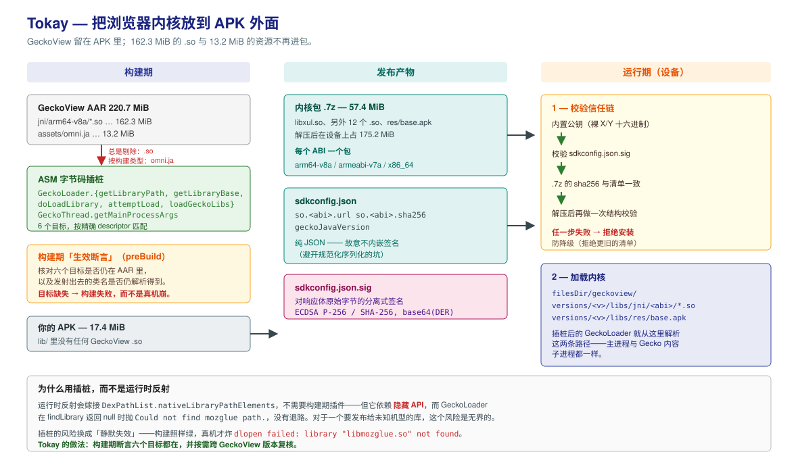

# Tokay

把 [GeckoView](https://github.com/mozilla/geckoview) 的内核从 APK 里挪出去，运行时再装回来。
对外接口照原生 `WebView` 的形状做，应用侧代码基本不用改。

```kotlin
val web = HybridWebView(context)
web.addJavascriptInterface("Bridge", myBridge)
web.evaluateJavascript("1 + 1") { result -> /* ... */ }
web.loadUrl("https://example.com")
```

内核走签名 OTA 下发，也可以随 APK 一起发。项目还在开发中，接入前先看[限制](#限制)。

## 能省多少

GeckoView 默认把内核打进 APK。下面都是实测值（GeckoView `147.0.20260212191108`、arm64-v8a）：

| | 内核留在 `lib/` | Tokay（OTA） | Tokay（随包） |
| --- | --- | --- | --- |
| 单 ABI APK | 约 198 MiB | 17.4 MiB | 74.9 MiB |
| 首次可用 | 装完即可 | 下载 57.4 MiB | 从 assets 解压（离线） |
| 信任根 | APK 签名 | 清单签名（P-256） | APK 签名 |
| `ndk.abiFilters` | 可选 | 可选 | 必需 |

原来那 198 MiB 里，`jni/arm64-v8a/*.so` 占 162.3 MiB（`libxul.so` 一个就 143.4），
`assets/omni.ja` 占 13.2 MiB。

## 用法

```groovy
// app/build.gradle
plugins {
    id 'com.happyboy.tokay.asm'
}
```

```kotlin
// Application.onCreate
GeckoSdk.initializePrewarm(this)                 // 可选：首屏之前先把内核预热起来
GeckoSdk.init(
    application = this,
    kernelSource = KernelSource(configUrl = "<你的清单地址>", publicKeyP256 = <裸 X||Y>),
)
GeckoSdk.installState.collect { /* Checking / Downloading / Extracting / Success / Failed */ }
```

清单地址没有默认值，留空会在 `init()` 当场失败。发什么、信谁，由接入方决定。

```bash
# 自建密钥对。仓库里的 demo-p256.* 是公开的演示密钥，只能跑通本地链路，别上生产。
bash tools/tokay-sign/sign.sh keygen ~/tokay-keys/my-p256.key ~/tokay-keys/my-p256.pub
bash tools/tokay-sign/sign.sh pubxy  ~/tokay-keys/my-p256.pub   # 裸 X/Y → 替换内置公钥常量

# 签「你即将下发的那份」清单，App 取的是 <configUrl>.sig
bash tools/tokay-sign/sign.sh sign ~/tokay-keys/my-p256.key serve/sdkconfig.json
```

### 内核随包

```kotlin
GeckoSdk.init(application, kernelSource = KernelSource.Packaged)
```

```bash
sh gradlew :demo:assembleDebug -PpackageGeckoKernel=true
```

同一个 `.7z` 随 APK 的 assets 一起发，首次运行从包里解压。这个模式要求声明 `ndk.abiFilters`，
没有就直接让构建失败：三个 ABI 都塞进一个 APK 会涨到约 505 MiB，比内核留在 `lib/` 里还大。

## 清单（sdkconfig.json）

内核从哪下、下完对不对，由这份 JSON 描述。App 取它的同时会取 `<清单地址>.sig` 验签。

```json
{
  "schemaVersion": 2,
  "geckoJavaVersion": "147.0.20260212191108",
  "so": {
    "arm64-v8a": {
      "url": "https://…/geckoview-arm64-v8a-147.0.20260212191108.7z",
      "sha256": "a36c5738…"
    },
    "x86_64": { "url": "", "sha256": "" }
  }
}
```

- `geckoJavaVersion` 必须等于 APK 里编进去的 GeckoView 版本，对不上就拒绝安装。
- `so.<abi>.sha256` 留空不是跳过校验，是直接拒绝安装。某个 ABI 不给包就整条留空。
- 签名覆盖清单的原始字节，改了清单就得重签。

仓库根目录那份就是本仓 demo 正在用的。

## 内部怎么做的

构建期把内核从 APK 里剔除，并改写 GeckoView 的六个方法（字节码插桩），让 `GeckoLoader` 去外部目录
找库文件。运行期内核被验签、解压到 `filesDir/geckoview/versions/<版本>/libs/`，再从那里加载。



不用运行时反射（[web-to-app](https://github.com/shiaho777/web-to-app) 走的就是那条路），是因为它依赖
`dalvik.system` 的隐藏 API，`findLibrary` 返回 null 时没有退路。插桩的代价是绑定 GeckoView 版本，
所以有两条构建期断言挡「改签名之后静默失效」。这条取舍、签名的信任链、以及踩过的坑，都写在
[AGENTS.md](AGENTS.md) 里。

## 下载试用

[demo APK](https://github.com/594happyboy/Tokay/releases/tag/demo-1)，arm64-v8a，debug 签名。装上打开，
首次启动会从同一个 release 下载 57.4 MiB 的内核包，之后就完全离线了。

那个 release 里还有内核包 `geckoview-arm64-v8a-*.7z`、清单 `sdkconfig.json` 和它的签名
`sdkconfig.json.sig`。

⚠️ 清单用的是仓库里那把公开的演示私钥，谁都能签一份出来，所以这个 APK 只适合看效果。

## 限制

- 接入方必须应用那个 Gradle 插件，没有预插桩的 AAR。
- OTA 模式首次启动必须联网。随包模式不用联网，但 APK 变大，首次运行仍要解压约 175 MiB。
- 运行时下载可执行代码可能与 Google Play 政策冲突。
- 不是 `android.webkit` 的 1:1 等价物：`WebViewClient` / `WebChromeClient` 那一套里，对话框、文件上传、
  权限询问、`data:` 导航、企业根证书都还没做。门面会如实上报能力位，不会静默变成空操作。
- JS 桥不做来源门禁：挂了桥之后，当前页面和同源脚本就能调那个对象的任意 `@JavascriptInterface`
  方法，XSS 就是入口。该不该挂桥，由宿主按 URL 自己判断。
- 系统 WebView 适配器只是兜底，不是等价实现。
- 构建期断言是源码级的，只证明类还在那个包，不证明发射出去的引用一定能解析。

## 兼容性

`140.0.20250707120347` 与 `147.0.20260212191108` 插桩目标均 6/6 通过（构建期断言，后者另有真机验证）。

## 许可

库主体 Apache-2.0；`tokay-asm/` MPL-2.0，因为它派生自 GeckoView 的集成代码。见 `LICENSE` 和 `NOTICE`。
